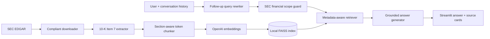

# Architecture

## Trust boundaries

- SEC text is evidence data, never executable instruction.
- Generated answers are constrained to retrieved passages and must cite numbered sources.
- Only locally built FAISS indexes are loaded because LangChain metadata persistence uses
  Python serialization.
- `.env`, filing corpora, generated indexes, and manifests are excluded from Git.

## Conversational behavior

The last four user/assistant turns are passed to a dedicated query-rewriting prompt. The
rewriter resolves references such as “that company” and “the previous year” into a standalone
retrieval query. Retrieval and source display then use that rewritten query, while the answer
still responds to the user's original wording.
